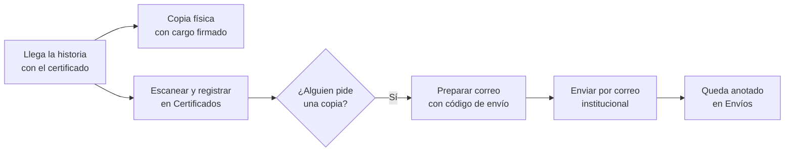

# Registro de Certificados de Defunción

[](LICENSE)


Herramienta para llevar el control de los certificados de defunción que llegan al archivo clínico con las historias de Hospitalización y Emergencia, y de los envíos de sus copias escaneadas por correo institucional.

Registra cada certificado con un nombre de PDF estandarizado, y prepara el correo de envío con un código único que queda en el correo y en la hoja. Funciona con Google Sheets y Apps Script, sin instalar software.

> [!NOTE]
> Recién implementado (noviembre de 2026). No es un desarrollo oficial de ninguna institución.

## Contenido

- [Cómo funciona](#cómo-funciona)
- [Qué hace](#qué-hace)
- [Hojas](#hojas)
- [Instalación](#instalación)
- [Uso](#uso)
- [Estructura](#estructura)
- [Versiones](#versiones)
- [Datos](#datos)
- [Licencia](#licencia)

## Cómo funciona



1. Cada certificado (o informe de defunción) se escanea y se registra en la hoja Certificados, que genera el nombre del PDF.
2. Cuando un médico o un área pide copias, se seleccionan las filas y el diálogo arma el correo con un código único (`ENV-2026-0001`).
3. El envío se hace solo por correo institucional, con copia al correo de la unidad y a la jefatura, y queda anotado en la hoja Envíos.

## Qué hace

- Completa la fecha de recepción al escribir el DNI.
- Genera el nombre del PDF sin tildes ni Ñ: `APELLIDOS-NOMBRES_HC_DNI_AAAA-MM-DD.pdf` (fecha de fallecimiento).
- Asigna un código de envío correlativo por año y evita códigos duplicados cuando registran varias personas a la vez.
- Arma el asunto y el cuerpo del correo a partir de los certificados seleccionados y de los datos del pedido.
- Crea el borrador en el Gmail de quien envía, con su firma configurada en Gmail.
- Recuerda a los solicitantes: el que se registra una vez completa solo su área y su correo la próxima vez.
- Cuenta en el Resumen los certificados recibidos por tipo y origen, los escaneados, los entregados y los correos enviados de cualquier mes.
- Protege las hojas de configuración y avisa antes de editar a mano las hojas que llena el diálogo.

## Hojas

| Hoja | Contenido | Se edita a mano |
| --- | --- | --- |
| Instrucciones | Pasos de uso y reglas | No |
| Certificados | Un registro por certificado recibido | Sí |
| Envíos | Un registro por certificado enviado, con su código de envío | Solo para corregir errores |
| Solicitantes | Médicos o áreas que piden copias, con su correo | Solo para corregir errores |
| Resumen | Totales del mes elegido | Solo el mes y el año |
| Listas | Opciones de las listas desplegables y correos de CC | Solo el propietario |

## Instalación

1. Crear una hoja de Google Sheets en blanco con la cuenta que será propietaria.
2. En <kbd>Extensiones</kbd> → <kbd>Apps Script</kbd>, pegar [`src/Codigo.gs`](src/Codigo.gs) en `Código.gs` y crear un archivo HTML llamado `Correo` con el contenido de [`src/Correo.html`](src/Correo.html).
3. En <kbd>Servicios</kbd>, agregar **Gmail API** (identificador `Gmail`). Se usa para poner la firma en el borrador.
4. Ejecutar la función `configurar` desde el editor: crea las seis hojas. Solo funciona con la hoja vacía.
5. En la hoja Listas, escribir el personal del área y los dos correos de CC.

<details>
<summary>Alternativa: subir el código con clasp</summary>

Con [clasp](https://github.com/google/clasp) instalado y la sesión iniciada, crear un `.clasp.json` con el ID del script y `"rootDir": "src"`, y luego:

```bash
clasp push
```

`.clasp.json` está en `.gitignore`: no se sube al repositorio.

</details>

<details>
<summary>Permisos que solicita el script</summary>

La primera vez, Google pide a cada persona autorizar el script. Los necesita para:

- leer y escribir la hoja de cálculo;
- crear el borrador del correo en el Gmail de quien envía;
- leer la firma de Gmail de quien envía.

</details>

## Uso

Todo se hace desde el menú <kbd>Registro</kbd> de la hoja:

| Opción | Qué hace |
| --- | --- |
| Nuevo certificado | Lleva a la primera fila libre de Certificados |
| Preparar correo de envío | Abre el diálogo con los certificados seleccionados |
| Ver envíos | Lleva a la primera fila libre de Envíos |

En el diálogo, completar el solicitante, el medio y la fecha del pedido, el correo de destino y quién envía. El botón principal avanza en dos pasos:

1. <kbd>1. Crear borrador en Gmail</kbd>: deja el correo en Borradores y bloquea los datos del pedido.
2. Adjuntar en Gmail los PDF que lista el diálogo y enviar.
3. <kbd>2. Registrar envío</kbd>: anota el envío y cierra el diálogo.

La vista previa del correo está plegada; ahí se puede copiar cada parte si Gmail falla.

> [!TIP]
> Para ubicar un envío, busque su código en la hoja Envíos o en el correo enviado.

## Estructura

```text
.
└── src
    ├── Codigo.gs          Menú, registro de envíos, borrador en Gmail y configuración inicial
    ├── Correo.html        Diálogo para preparar el correo de envío
    └── appsscript.json    Manifiesto de Apps Script (zona horaria, entorno y servicio de Gmail)
```

## Versiones

Se usa [versionado semántico](https://semver.org/lang/es/): `MAYOR.MENOR.PARCHE`.

| Cambio | Ejemplo | Sube |
| --- | --- | --- |
| Obliga a cambiar las hojas o los datos ya registrados | Una columna nueva en Certificados | MAYOR |
| Función nueva o cambio visible que no toca los datos | Rediseño del diálogo | MENOR |
| Corrección sin funciones nuevas | Un texto mal escrito | PARCHE |

Los cambios de cada versión están en [Releases](../../releases).

## Datos

Los certificados, envíos y solicitantes viven en la hoja y en el Drive de quien la usa; el repositorio no contiene datos.

> [!WARNING]
> Los certificados de defunción contienen datos personales y de salud. Los PDF escaneados no deben subirse aquí.

## Licencia

[MIT](LICENSE)
